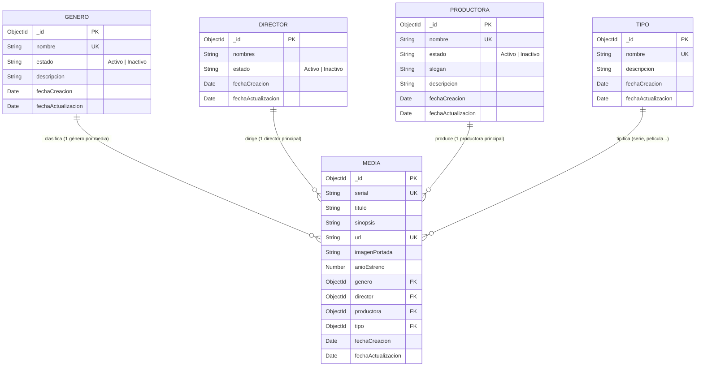

# Diseño de la base de datos (MongoDB)

Base de datos: `peliculas_db` · Motor: MongoDB · ODM: Mongoose

## Diagrama entidad-relación

## Colecciones

| Colección | Campos | Restricciones |
|-----------|--------|---------------|
| **generos** | nombre, estado, descripcion, fechaCreacion, fechaActualizacion | `nombre` único y requerido; `estado` ∈ {Activo, Inactivo} (por defecto Activo) |
| **directors** | nombres, estado, fechaCreacion, fechaActualizacion | `nombres` requerido; `estado` ∈ {Activo, Inactivo} |
| **productoras** | nombre, estado, slogan, descripcion, fechaCreacion, fechaActualizacion | `nombre` único y requerido; `estado` ∈ {Activo, Inactivo} |
| **tipos** | nombre, descripcion, fechaCreacion, fechaActualizacion | `nombre` único y requerido |
| **medias** | serial, titulo, sinopsis, url, imagenPortada, anioEstreno, genero, director, productora, tipo, fechaCreacion, fechaActualizacion | `serial` único; `url` única; referencias (ObjectId) a las 4 colecciones |

> Mongoose pluraliza automáticamente los nombres de colección (`Director` → `directors`).

## Reglas de negocio implementadas

1. Una producción pertenece a **un único** género, director, productora y tipo.
2. Al crear/editar una producción solo se aceptan **géneros, directores y productoras ACTIVOS**; el tipo solo debe existir.
3. `serial` y `url` son **únicos** en Media.
4. `fechaCreacion` y `fechaActualizacion` se gestionan automáticamente.
5. No se puede **eliminar** un género, director, productora o tipo que esté asociado a alguna producción (HTTP 409); se recomienda inactivarlo.
6. Datos iniciales (`npm run seed`): géneros acción, aventura, ciencia ficción, drama y terror; tipos película y serie.
